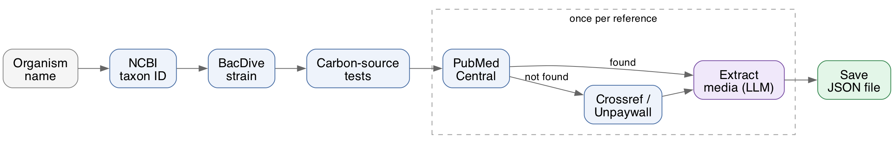

# GenoScape: An Agentic Pipeline for Mining Genotype × Environment → Growth-Phenotype Data from NCBI, BacDive and the Literature

GenoScape takes the name of a prokaryote (e.g. "Escherichia coli K-12") and
produces a set of JSON records pairing its genome, a carbon source, and
whether it grows on it — with the exact growth medium pulled from the paper
behind that result, where available.




## 1. Install

```bash
pip install -r requirements.txt
```

## 2. Add your keys

Create a file named `.env` in the project root with:

```
OPENROUTER_API_KEY=...
```

(or `ANTHROPIC_API_KEY=...` instead, if you use Anthropic directly)

Optional, but worth adding:

```
UNPAYWALL_EMAIL=you@email.com
NCBI_API_KEY=...
```

`UNPAYWALL_EMAIL` lets GenoScape find a free copy of a paper that's otherwise
behind a paywall — without it, many papers come back unreadable and their
medium is left empty. It must be your real address; Unpaywall rejects
placeholders. `NCBI_API_KEY` just raises the rate limit if you run this a lot.

## 3. Run it

```bash
python -m examples.Genoscape --prokaryote_name "Acetobacter cerevisiae"
```

Swap in any organism name you want. It will take a little while — it's
looking the organism up, checking its known growth data, and reading papers.

## 4. Get your results

Each organism gets one file under `data/strain_media/`, named after the
strain and its NCBI ID, e.g. `data/strain_media/acetobacter_cerevisiae_178900.json`.
It lists every carbon source tested, with the growth medium pulled from the
paper for each one:

```json
{
  "strain_name": "Acetobacter cerevisiae",
  "ncbi_id": "178900",
  "strain_id": 12,
  "genome": "GCA_001580535",
  "carbon_sources": [
    {
      "carbon_source": "glycerol",
      "growth": true,
      "full_media": [
        {"name": "GYC medium", "ingredients": [{"name": "glucose", "amount": "50 g/l"}],
         "temperature": "28°C", "ph": "6.8", "notes": null}
      ],
      "provenance": {"reference_title": "...", "doi": "..."}
    },
    {"carbon_source": "ethanol", "growth": false, "full_media": [], "provenance": {"...": "..."}}
  ]
}
```

`full_media` holds whatever a model found by reading the actual paper behind
that result. It's left empty when the paper wasn't readable or didn't
describe a medium — it's never guessed. Reading papers uses the same key you
set up in step 2.

## 5. Evaluate the growth answers (optional)

Compare the full pipeline against a bare LLM with no tools, on a small set of
strains with known answers (`data/ground_truth.json`):

```bash
python -m examples.eval
```

This runs 4 conditions (the pipeline and a bare LLM, each with Haiku and
Sonnet), scores each answer with an LLM judge (Opus), and writes:

- `data/eval_results.json` — every answer and its judged accuracy
- `data/eval_plots/tokens.png` and `accuracy.png` — bar charts comparing all 4

Already-answered strains are reused, so re-running only fills in what's
missing. Add `--force` to redo everything, or `--conditions bare_haiku` to run
just one.

## 6. Evaluate the medium extraction (optional)

Check how well GenoScape reads a growth medium out of a paper. This compares
the two extraction methods — sending the whole paper in one call, versus the
ranked-paragraph retrieval the pipeline actually uses:

```bash
python -m examples.eval_media --n 10
```

It pulls open-access papers from PubMed Central, keeps only the ones that
really do state a medium's composition, runs both methods on each, and has an
LLM judge score each result against the paper itself — so there's no ground
truth to write by hand. Writes `data/eval_media_results.json`.

Last run over 10 papers:

| | Whole paper | Retrieval |
|---|---|---|
| Accuracy | 0.81 ± 0.20 | 0.86 ± 0.16 |
| Tokens | 63,428 | 20,172 |

## 7. Compare against Claude on its own

`data/strain_media_results.json` holds the same kind of records, but produced
by giving Claude (Sonnet) a set of instructions instead of running the
pipeline. It's there as a comparison point: how accurate is GenoScape next to
just asking Claude?

To chart how far that run actually got — for each strain, how often it managed
to read the cited paper at all, and how often it got a medium out of it:

```bash
python -m examples.plot_results \
    --media-results data/strain_media_results.json --media-label "Claude (sonnet)"
```

To also score its carbon-source growth calls with the same judge used in
step 5, and add it to the accuracy chart as one more bar:

```bash
python -m examples.plot_results \
    --eval-results data/eval_results.json \
    --media-results data/strain_media_results.json --media-label "Claude (sonnet)" \
    --judge-media-accuracy
```

That last one makes live judge calls; the others don't.

## 8. Re-draw the charts

Plotting is a separate script, so you can redraw from any saved results
without re-running anything (and without spending anything):

```bash
python -m examples.plot_results --eval-results data/eval_results.json
python -m examples.plot_results --media-eval-results data/eval_media_results.json
```

Charts land in `data/eval_plots/`.

## Licence

MIT. See [LICENSE](LICENSE).
